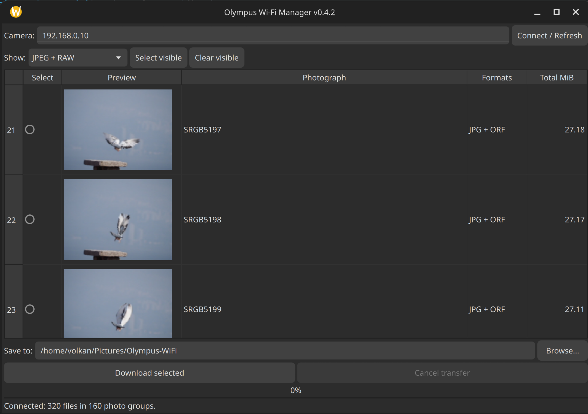

# Olympus Wi-Fi Manager

A lightweight Python/Qt application for browsing and downloading original JPEG and Olympus ORF RAW photos from compatible Olympus cameras over their camera-hosted Wi-Fi network.

**Hardware tested:** Olympus OM-D E-M1 Mark II, firmware 3.4  
**Operating system tested:** Ubuntu Studio 26.10 (KDE Plasma)  
**Release:** v0.5.0 (additional camera compatibility unverified)

This project is independent and not affiliated with OM Digital Solutions or Olympus.

## Features

- Automatically detect compatible cameras through the active Wi-Fi gateway (Linux/NetworkManager)
- Support manual camera IP entry when automatic detection is unavailable
- Enumerate camera photo directories over HTTP
- Display camera-provided thumbnails
- Group JPEG and ORF files with matching basenames
- Select photos, filter formats, and download original bytes
- Skip existing files whose sizes match; verify completed download sizes
- Use `.part` files during transfer, with cancellation support
- Command-line tool without third-party Python dependencies

**Note:** Duplicate detection is based on file size, **not checksums**. Thumbnails are limited by the resolution supplied by the camera. No remote shutter control or live view is provided.

## Installation

Connect the computer to the camera's Wi-Fi network (typically camera address `192.168.0.10`). Download or clone this repository.

On Ubuntu Studio, you may install the distro's PySide6 package:

```bash
sudo apt install python3-pyside6.qtwidgets
```

Alternatively, in a Python virtual environment:

```bash
python3 -m venv .venv
. .venv/bin/activate
python -m pip install -r requirements.txt
```

## GUI

```bash
python3 olympus_wifi_gui.py
```

Click **Detect Camera** to identify a compatible camera on the active Wi-Fi network. The detected address automatically populates the camera IP field; detection does not initiate a connection or download.

Then click **Connect / Refresh**, select photos or groups, choose a destination, and click **Download selected**. Files are saved under `<destination>/DCIM/<camera-folder>/`.

If detection fails, check that the computer is connected to the camera's Wi-Fi network, or enter the camera IP address manually. Automatic detection currently requires Linux, NetworkManager (`nmcli`), and the `ip` command. It checks the active Wi-Fi gateway for a compatible `/DCIM` directory-listing response; it does not scan the network.

The format filter affects which files are downloaded from selected groups. For JPEG+ORF pairs, use **JPEG + RAW** to download both.

## CLI

```bash
python3 olympus_wifi_manager.py --list
python3 olympus_wifi_manager.py --list --format orf
python3 olympus_wifi_manager.py --download SRGB5177.JPG
python3 olympus_wifi_manager.py --download SRGB5177.JPG --download SRGB5177.ORF
python3 olympus_wifi_manager.py --all --format orf
python3 olympus_wifi_manager.py --all --dest ~/Pictures/Olympus-WiFi
```

For a different camera IP, add `--host ADDRESS`.

## Tests

```bash
python3 -m unittest discover -s tests -v
```

Tests use synthetic camera directory listings and local temporary files; they do not require a camera.

## Known limitations

- Only the E-M1 Mark II with firmware 3.4 has been tested.
- Automatic detection may not work when the camera is not the Wi-Fi gateway or uses a different directory protocol.
- Camera Wi-Fi may disconnect the computer from its usual Internet connection.
- The camera must remain powered and in Wi-Fi mode.
- File size verification does not provide cryptographic integrity verification.
- The GUI may take time to retrieve thumbnails from a large card.
- A partially transferred file is discarded on cancellation or failure rather than resumed.
- Metadata is retained inside the original file bytes; filesystem modification timestamps are not restored from the camera.
- Camera HTTP is unencrypted; use the camera's private Wi-Fi network.
- Some Olympus cameras may use a different directory or thumbnail protocol.

## License

MIT — see [LICENSE](LICENSE).

## Contributing

Compatibility reports should include camera model, firmware version, Linux distribution, and whether directory listing, thumbnail preview, JPEG download, and ORF download work. Do not publish Wi-Fi passwords or private photos.

## Screenshot


